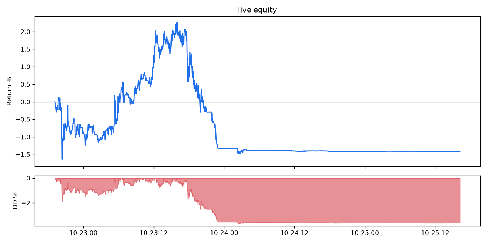

# TMN Quant Engine — run report

## SHADOW

- Equity: **4,964,229 TMN** (-0.715%)
- Max drawdown: **0.866%**
- Traded volume: 0 TMN


- Market maker: **4 fills** (3 buys, 1 sells), 1 risk exits, realised PnL **-10,984 TMN**, maker round trips avg 226.7 bps

| coin | buys | sells | exits | realised PnL TMN |
|---|---|---|---|---|
| BNB | 1 | 0 | 0 | 0 |
| FIL | 2 | 1 | 1 | -10,984 |

- AI supervisor decisions: 33 (sources: {'fallback': 1, 'llm:boxapi': 32})
- Events: {'startup': 41, 'policy': 33, 'quote': 1318, 'state_restored': 38, 'quote_skipped': 4, 'usdt_ref_check': 13, 'quote_blocked': 321, 'quote_unblocked': 306, 'error': 5, 'buy_blocked': 1081, 'buy_unblocked': 909, 'instance_superseded': 17, 'fill': 4, 'exit': 1, 'quote_failed': 7, 'coin_skipped': 63, 'regime': 9, 'sleeve_order': 56, 'sleeve_order_failed': 5, 'sleeve_fill': 26, 'state_reset': 1}

### Latest AI decision
```json
{
  "markets": {
    "GALA": 1.0,
    "CHZ": 0.9,
    "DOT": 1.5
  },
  "pause": false,
  "reasoning": "I pick GALA and CHZ because both have Toman spreads above our 80 bps threshold (GALA 100.0 bps, CHZ 83.4 bps) and reasonable 24h TMN volumes (GALA 2,307m, CHZ 1,729m); GALA's fv_vol is moderate (224 bps) so h=1.0% is appropriate, CHZ's fv_vol is low (59 bps) so h=0.9% to quote more aggressively. I include DOT as a third slot because its Toman spread is very wide (137.7 bps) albeit with extreme fv volatility (2,306 bps), so I set h=1.5% to protect against adverse selection. I avoid ARB (buy_blocked: book sliding) and other sub-80-bps markets (e.g. SOL 38 bps, XRP 29.3 bps). For sleeves, USDT/TMN 48h +4.06% keeps us in the rial-weakening regime, so keep rial exposure at 1.0 (full); beta stays at the engine's current scale 0.8 and I keep the beta assets to PEPE/ADA/LINK (the current beta weights) to capture momentum while respecting the sleeve's stop and the end_wind_down schedule.",
  "tool_trace": [],
  "source": "llm:boxapi"
}
```

## LIVE

- Equity: **4,929,260 TMN** (-1.415%)
- Max drawdown: **3.650%**
- Traded volume: 890,411 TMN



- Market maker: **2 fills** (2 buys, 0 sells), 2 risk exits, realised PnL **-4,601 TMN**

| coin | buys | sells | exits | realised PnL TMN |
|---|---|---|---|---|
| DOT | 1 | 0 | 1 | -2,492 |
| PENGU | 1 | 0 | 1 | -2,109 |

- AI supervisor decisions: 208 (sources: {'llm:boxapi': 208})
- Events: {'coin_skipped': 441, 'live_self_test': 63, 'cancel_all': 11, 'startup': 11, 'regime': 14, 'policy': 208, 'sleeve_order': 329, 'quote': 5878, 'buy_blocked': 14950, 'buy_unblocked': 14887, 'state_restored': 62, 'sleeve_fill': 30, 'orphan_adopted': 1, 'fill': 2, 'exit': 2, 'sleeve_reweight': 2, 'sleeve_stop': 2}

### Latest AI decision
```json
{
  "markets": {
    "SUI": 1.5,
    "ENA": 1.5,
    "CHZ": 1.0
  },
  "pause": false,
  "reasoning": "I pick at most three markets with Toman spread >= 80 bps. SUI (spread 169.3 bps, vol24h 5648M TMN) is wide but fv_vol is large (fv_vol_bps 616.6) so I quote very wide h=1.5% to avoid adverse selection. ENA (spread 186.1 bps, vol24h 2343M TMN) also has elevated fv_vol (394.9 bps) so I set h=1.5% to prioritise few conservative maker fills. CHZ (spread 142.4 bps, fv_vol_bps 81.6) has lower fv volatility so I use a moderate h=1.0% to capture spread while limiting being picked off; CHZ volume is small (71M) so exposure is cautious. I avoid DOT and PENGU because DOT currently shows a buy-block and a recent losing round trip (avg -76.1 bps, realised -2,492 TMN) and PENGU had a losing fill (avg -178.3 bps, realised -2,109 TMN). I also avoid markets with sliding Toman-book guards (FIL/IMX/BCH/GALA/APE) flagged as buy_blocked. Portfolio sleeves set to zero because USDT/TMN 48h is -1.27% and the regime cap is 0.0 (no sleeve exposure); beta_assets are listed per the sleeve universe (PEPE, ADA, LINK) though scale is 0 due to the cap.",
  "tool_trace": [],
  "source": "llm:boxapi"
}
```
