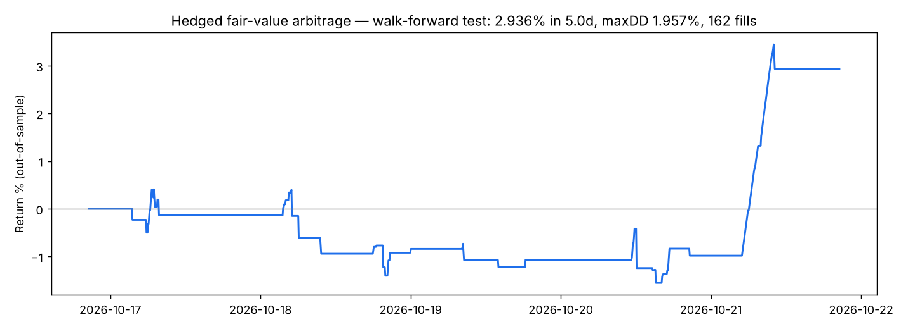
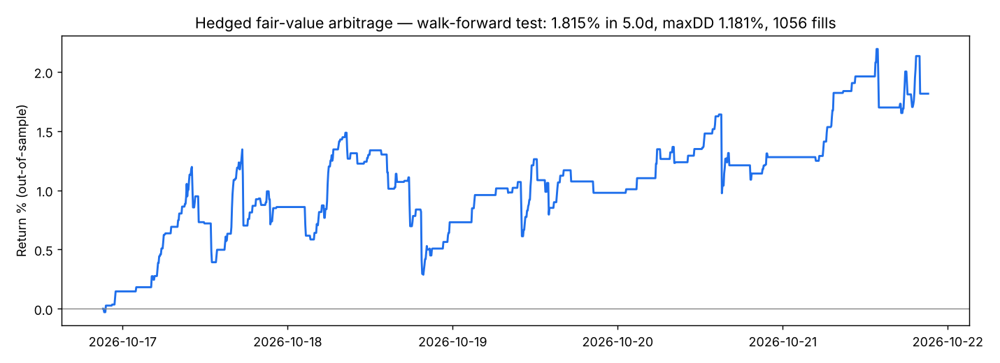

# TMN Quant Engine — run report

## Walk-forward backtest (out-of-sample half)

```json
{
  "data/m5_all.json": {
    "data_days": 10.0,
    "fees": {
      "tmn_maker": 0.0025,
      "tmn_taker": 0.003,
      "usdt_maker": 0.001,
      "usdt_taker": 0.0013
    },
    "round_trip_cost_pct": 0.68,
    "chosen_margins_from_train": {
      "ADA": 0.8,
      "BNB": 0.8,
      "BTC": 0.4,
      "DOGE": 0.8,
      "TRX": 0.4
    },
    "test_days": 5.0,
    "test_fills": 162,
    "test_fills_per_day": 32.4,
    "test_avg_net_bps_per_fill": 21.3,
    "test_win_rate_pct": 80.2,
    "test_return_pct": 2.936,
    "test_return_per_3_days_pct": 1.75,
    "test_max_drawdown_pct": 1.957,
    "per_coin_test": {
      "ADA": {
        "fills": 63,
        "avg_bps": 21.1
      },
      "BNB": {
        "fills": 18,
        "avg_bps": 20.2
      },
      "BTC": {
        "fills": 2,
        "avg_bps": -9.0
      },
      "DOGE": {
        "fills": 7,
        "avg_bps": 13.7
      },
      "TRX": {
        "fills": 72,
        "avg_bps": 23.4
      }
    },
    "assumptions": "pessimistic: trade-through fills, fill size <= 25% of the bar's Toman volume, worst-of hedge prices, full taker fees on hedge"
  },
  "data/m5_extra.json": {
    "data_days": 10.0,
    "fees": {
      "tmn_maker": 0.0025,
      "tmn_taker": 0.003,
      "usdt_maker": 0.001,
      "usdt_taker": 0.0013
    },
    "round_trip_cost_pct": 0.68,
    "chosen_margins_from_train": {
      "AAVE": 0.8,
      "APE": 1.0,
      "CAKE": 0.6,
      "FIL": 0.6,
      "GALA": 0.6,
      "HYPE": 0.6,
      "PENGU": 0.4,
      "SHIB": 0.6,
      "UNI": 0.8,
      "WLD": 1.3,
      "XAUT": 0.8
    },
    "test_days": 5.0,
    "test_fills": 1056,
    "test_fills_per_day": 211.1,
    "test_avg_net_bps_per_fill": 39.0,
    "test_win_rate_pct": 89.7,
    "test_return_pct": 1.815,
    "test_return_per_3_days_pct": 1.084,
    "test_max_drawdown_pct": 1.181,
    "per_coin_test": {
      "AAVE": {
        "fills": 156,
        "avg_bps": 71.1
      },
      "APE": {
        "fills": 63,
        "avg_bps": 30.3
      },
      "CAKE": {
        "fills": 103,
        "avg_bps": 44.6
      },
      "FIL": {
        "fills": 266,
        "avg_bps": 38.8
      },
      "GALA": {
        "fills": 102,
        "avg_bps": 29.2
      },
      "HYPE": {
        "fills": 32,
        "avg_bps": 57.0
      },
      "PENGU": {
        "fills": 276,
        "avg_bps": 24.0
      },
      "SHIB": {
        "fills": 14,
        "avg_bps": 37.4
      },
      "UNI": {
        "fills": 19,
        "avg_bps": 20.7
      },
      "WLD": {
        "fills": 25,
        "avg_bps": 37.6
      }
    },
    "assumptions": "pessimistic: trade-through fills, fill size <= 25% of the bar's Toman volume, worst-of hedge prices, full taker fees on hedge"
  }
}
```




## SHADOW

_No records yet._

## LIVE

_No records yet._
