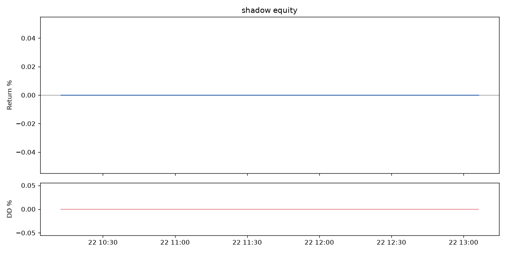

# TMN Quant Engine — run report

## SHADOW

- Equity: **5,000,000 TMN** (+0.000%)
- Max drawdown: **0.000%**
- Traded volume: 0 TMN



- AI supervisor decisions: 12 (sources: {'fallback': 1, 'llm:boxapi': 11})
- Events: {'startup': 7, 'policy': 12, 'quote': 191, 'state_restored': 6, 'quote_skipped': 4, 'usdt_ref_check': 5, 'quote_blocked': 90, 'quote_unblocked': 86, 'error': 1}

### Latest AI decision
```json
{
  "enabled_coins": [
    "FIL",
    "PENGU",
    "AAVE",
    "GALA",
    "ADA",
    "TRX",
    "CAKE",
    "AVAX",
    "WLD",
    "APE",
    "HYPE",
    "SHIB",
    "LINK",
    "DOGE",
    "UNI",
    "PUMP",
    "BNB",
    "SOL"
  ],
  "margin_mult": 1.0,
  "usdt_hold_frac": 0.0,
  "pause": false,
  "reasoning": "USDT trend data is unavailable (change_6h and change_24h are null) though USDT/TMN mid is 270,707; per rule we hold USDT only when 6h and 24h changes are both >0, so set usdt_hold_frac=0.0. Two coins (AAVE, WLD) show temporary 'Toman book sliding' blocks (informed-seller guard), so quoting is already suspended but this is not long-lived evidence to disable them. No coin has minutes_below_-200bps or ≥3 losing fills, so disable list remains empty. Keep margin_mult at 1.0 and do not pause — market looks normal with largest live deviation APE +110.1 bps and most coins within ±100 bps.",
  "tool_trace": [
    {
      "tool": "get_usdt_tmn_trend",
      "args": {}
    },
    {
      "tool": "get_news",
      "args": {
        "topic": "iran"
      }
    }
  ],
  "source": "llm:boxapi"
}
```

## LIVE

_No records yet._
